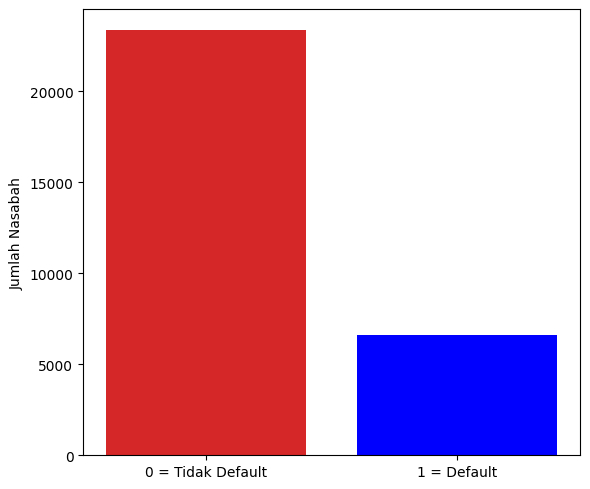
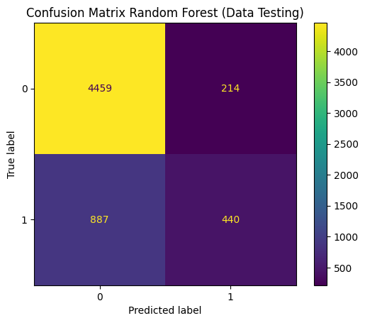
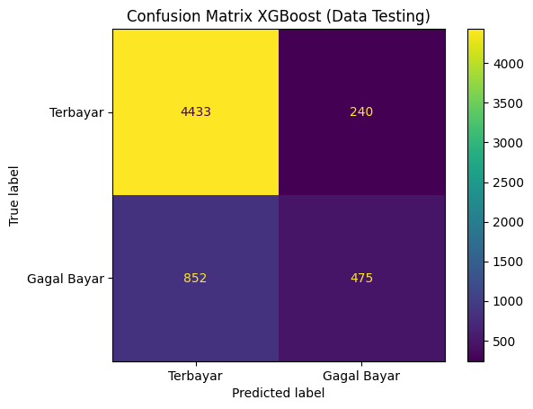
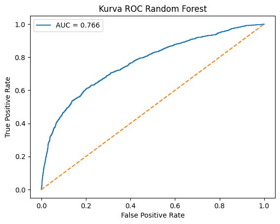
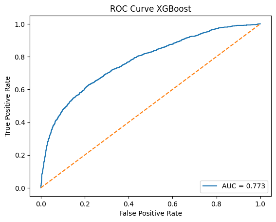
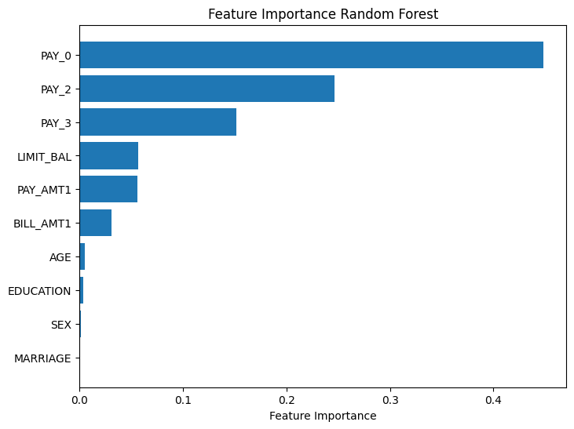
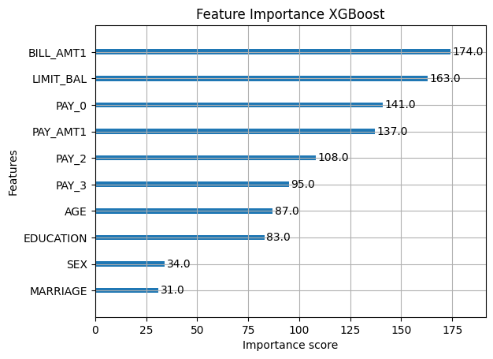

# Credit-Card-Customer-Classification
Studi Perbandingan Random Forest dan XGBoost


# Prediksi Gagal Bayar Kartu Kredit: Random Forest vs. XGBoost

> **Jenis proyek:** Supervised Machine Learning · Classification · Exploratory Data Analysis  
> **Domain:** Banking & Credit Risk Analytics  
> **Pertanyaan bisnis:** Bagaimana informasi kredit dan perilaku pembayaran nasabah dapat membantu mengidentifikasi nasabah yang berpotensi gagal membayar kartu kredit pada bulan berikutnya?

## Gambaran Umum Proyek

Proyek ini mengeksplorasi dataset perbankan dan membandingkan **Random Forest** dan **XGBoost** untuk memprediksi apakah nasabah akan gagal membayar kartu kredit pada bulan berikutnya.

Alur kerja mencakup pemeriksaan data, pemeriksaan kualitas data, Exploratory Data Analysis (EDA), pemilihan fitur, pelatihan model, eksperimen hyperparameter, evaluasi model, analisis ROC, dan perbandingan feature importance.

> **Catatan:** Hasil ini bersifat eksperimental dan belum siap digunakan sebagai satu-satunya dasar pengambilan keputusan kredit. Manfaat bisnis yang dijelaskan dalam README ini merupakan potensi penerapan, bukan hasil finansial yang telah diukur.

## Sorotan Proyek

### 1. EDA: Distribusi target


<!-- Simpan grafik dari notebook sebagai images/target-distribution.png -->


### 2. Evaluasi model: Confusion matrix

<!-- Simpan gambar gabungan sebagai images/confusion-matrix-comparison.png -->

<p align="center">
  
  
</p>


### 3. Evaluasi model: ROC curve

<!-- Simpan grafik gabungan sebagai images/roc-curve-comparison.png -->
<p align="center">
  
  
</p>


### 4. Interpretasi model: Feature importance

Grafik gabungan fitur teratas dari kedua model mendukung temuan bahwa variabel status pembayaran merupakan prediktor penting dalam model yang telah dilatih.

<!-- Simpan grafik gabungan sebagai images/feature-importance-comparison.png -->
<p align="center">
  
  
</p>

> **Sebelum dipublikasikan:** Tautan gambar ini masih berupa placeholder. Buat folder `images/` dan unggah file dengan nama yang sama seperti di atas, atau ubah path Markdown agar sesuai dengan nama file Anda. Jangan biarkan tautan gambar rusak pada README yang dipublikasikan.

## Key Business Question

**Bagaimana informasi kredit nasabah dan riwayat perilaku pembayaran dapat digunakan untuk memprediksi risiko gagal bayar kartu kredit pada bulan berikutnya?**

Pertanyaan pendukung:
- Bagaimana distribusi default dalam dataset?
- Bagaimana status pembayaran, credit limit, bill amounts, dan payment amounts bervariasi pada setiap kelas default?
- Seberapa baik Random Forest dan XGBoost membedakan nasabah default dan non-default?
- Fitur apa yang memiliki nilai importance tertinggi pada setiap model?
- Validasi tambahan apa yang diperlukan sebelum prediksi digunakan dalam proses credit risk?

## Dataset

Notebook menggunakan `Perbankan.csv`, yang berisi **30.000 baris dan 25 kolom**, termasuk identifier dan target.

### Target variable

`default.payment.next.month`

- `0`: Tidak gagal bayar
- `1`: Gagal bayar

### Selected features

Kedua model menggunakan 10 fitur berikut:

`LIMIT_BAL`, `AGE`, `SEX`, `EDUCATION`, `MARRIAGE`, `PAY_0`, `PAY_2`, `PAY_3`, `BILL_AMT1`, dan `PAY_AMT1`.

Dataset secara keseluruhan juga berisi kolom status pembayaran `PAY_4`–`PAY_6`, nilai tagihan `BILL_AMT1`–`BILL_AMT6`, serta nilai pembayaran `PAY_AMT1`–`PAY_AMT6`. Kolom `ID` merupakan identifier, bukan fitur perilaku nasabah.

> Notebook menggunakan nama kolom dan kode kategori sebagaimana tersedia. Periksa dokumentasi dataset asli sebelum menafsirkan kategori yang dikodekan.

## Tools and Libraries

- Python
- Pandas and NumPy
- Matplotlib and Seaborn
- Scikit-learn
- XGBoost
- Google Colab / Jupyter Notebook

## Alur Kerja

### 1. Pemeriksaan data dan kualitas data

Notebook memeriksa data menggunakan metode seperti `head()`, `info()`, dan `describe()`. Notebook Random Forest memeriksa missing values dan baris duplikat.

Hasil yang tercatat pada notebook Random Forest:
- Tidak ditemukan missing values.
- Tidak ditemukan baris duplikat.
- Kolom `ID` dikeluarkan dari EDA DataFrame karena merupakan identifier.

### 2. Exploratory Data Analysis

Notebook Random Forest mengeksplorasi:
- Distribusi target untuk nasabah default dan non-default.
- Hubungan antara `PAY_0` dan target.
- Jumlah nasabah pada kelas default di setiap kategori `PAY_AMT1`.
- Distribusi `LIMIT_BAL` dan kelompok credit limit.
- Distribusi `BILL_AMT1`–`BILL_AMT6`.
- Correlation matrix untuk variabel numerik.

Grafik-grafik ini membantu mengeksplorasi pola dalam dataset. Correlation dan feature importance tidak boleh ditafsirkan sebagai bukti hubungan sebab-akibat.

### 3. Feature selection dan train-test split

Kedua notebook menggunakan 10 fitur terpilih yang sama dan `default.payment.next.month` sebagai target.

Notebook menggunakan `train_test_split` dengan:
- Training set: 24.000 data (80%)
- Test set: 6.000 data (20%)
- `random_state=42`
- `stratify=y`

Pembagian ini memberikan rancangan split yang sama. Untuk perbandingan final yang kuat, pastikan kedua model dievaluasi menggunakan baris test yang benar-benar sama dan data test tidak digunakan untuk tuning model.

## Model 1: Random Forest

### Model awal

Konfigurasi awal Random Forest adalah:

```python
RandomForestClassifier(
    n_estimators=200,
    max_depth=10,
    random_state=42
)
```

Hasil awal pada test set yang tercatat:

| Metrik | Class 0: Tidak gagal bayar | Class 1: Gagal bayar |
|---|---:|---:|
| Precision | 0.84 | 0.67 |
| Recall | 0.95 | 0.35 |
| F1-score | 0.89 | 0.46 |
| Support | 4,673 | 1,327 |

- **Accuracy:** 81.77%
- **Confusion matrix:** `[[4437, 236], [858, 469]]`

Model awal lebih efektif mengidentifikasi nasabah non-default dibandingkan nasabah default. Recall kelas default sebesar 0,35 berarti banyak kasus default yang sebenarnya terjadi tidak terdeteksi.

### Konfigurasi final terpilih dalam notebook

```python
RandomForestClassifier(
    n_estimators=300,
    max_depth=4,
    criterion="entropy",
    min_samples_leaf=10,
    max_features="sqrt",
    random_state=42
)
```

Notebook menjalankan eksperimen `GridSearchCV` five-fold secara terpisah dengan ROC-AUC sebagai scoring. Sebagian hasil tuning yang tercatat tidak lengkap, sehingga nilai tersebut tidak boleh dianggap sebagai bukti bahwa kombinasi parameter yang digunakan merupakan kombinasi optimal secara keseluruhan.

### Hasil diagnostik final Random Forest

- **Confusion matrix:** `[[4459, 214], [887, 440]]`
- **Accuracy yang dihitung dari matrix:** 81,65%
- **ROC-AUC yang ditampilkan pada grafik:** 0,766

Jika tidak menggunakan gambar perbandingan gabungan di bagian atas, letakkan screenshot confusion matrix dan ROC curve Random Forest di sini.

<!-- Gambar individual opsional:


-->

Feature importance tertinggi yang tercatat dalam notebook:

| Peringkat | Feature | Importance |
|---:|---|---:|
| 1 | `PAY_0` | 0.447985 |
| 2 | `PAY_2` | 0.246457 |
| 3 | `PAY_3` | 0.151867 |
| 4 | `LIMIT_BAL` | 0.056909 |
| 5 | `PAY_AMT1` | 0.056253 |
| 6 | `BILL_AMT1` | 0.030764 |

## Model 2: XGBoost

### Eksperimen hyperparameter

Notebook XGBoost menjalankan eksperimen `GridSearchCV` five-fold secara terpisah dengan ROC-AUC sebagai scoring. Nilai terbaik yang tercatat dari masing-masing pencarian adalah:

| Parameter | Nilai pengujian terbaik | Rata-rata cross-validation ROC-AUC |
|---|---:|---:|
| `n_estimators` | 100 | 0.7597 |
| `max_depth` | 4 | 0.7716 |
| `min_child_weight` | 7 | 0.7657 |
| `learning_rate` | 0.05 | 0.7782 |
| `gamma` | 2.0 | 0.7745 |
| `colsample_bylevel` | 0.25 | 0.7675 |
| `subsample` | 1.0 | 0.7597 |

Hasil ini berasal dari pencarian satu parameter pada satu waktu secara terpisah, dan setiap pencarian dimulai dari estimator default. Nilai tersebut bukan skor dari satu kombinasi parameter yang dioptimalkan secara bersama-sama. Pencarian `colsample_bylevel` juga mencakup kandidat string yang tidak valid (`log2` dan `sqrt`); pecahan numerik seperti `0.25` dan `1.0` sesuai untuk parameter ini.

### Konfigurasi yang digunakan untuk grafik diagnostik

```python
XGBClassifier(
    n_estimators=100,
    colsample_bylevel=0.25,
    gamma=2.0,
    learning_rate=0.05,
    max_depth=4,
    min_child_weight=7,
    subsample=1.0,
    eval_metric="logloss"
)
```

### Hasil diagnostik XGBoost

- **Confusion matrix:** `[[4433, 240], [852, 475]]`
- **Accuracy yang dihitung dari matrix:** 81,80%
- **ROC-AUC yang ditampilkan pada grafik:** 0,773

Jika tidak menggunakan gambar perbandingan gabungan di bagian atas, letakkan screenshot confusion matrix dan ROC curve XGBoost di sini.

<!-- Gambar individual opsional:


-->

Feature importance tertinggi yang tercatat dalam notebook:

| Peringkat | Feature | Importance |
|---:|---|---:|
| 1 | `PAY_0` | 0.300870 |
| 2 | `PAY_2` | 0.288271 |
| 3 | `PAY_3` | 0.194083 |
| 4 | `PAY_AMT1` | 0.063116 |
| 5 | `LIMIT_BAL` | 0.051644 |
| 6 | `BILL_AMT1` | 0.039755 |

**Catatan konfigurasi:** Cell terakhir pada notebook XGBoost melatih konfigurasi yang berbeda (`learning_rate=0.1`, `max_depth=3`) dan menampilkan accuracy 81,90%. Jangan mencampur angka tersebut dengan grafik diagnostik di atas karena grafik tersebut dihasilkan oleh konfigurasi yang berbeda.

## Random Forest vs. XGBoost

Tabel berikut membandingkan grafik diagnostik final Random Forest yang tersimpan dengan grafik diagnostik XGBoost. Keduanya menggunakan rancangan split dan fitur terpilih yang sama, tetapi konfigurasi finalnya berbeda. Anggap hasil ini sebagai perbandingan eksperimental, bukan hasil pemilihan model yang definitif.

| Metrik | Random Forest | XGBoost |
|---|---:|---:|
| Accuracy | 81.65% | 81.80% |
| ROC-AUC | 0.766 | 0.773 |
| True negatives | 4,459 | 4,433 |
| False positives | 214 | 240 |
| False negatives | 887 | 852 |
| True positives | 440 | 475 |
| Precision kelas default | 67.3% | 66.4% |
| Recall kelas default | 33.2% | 35.8% |
| F1-score kelas default | 44.5% | 46.6% |

### Interpretasi

- XGBoost memiliki accuracy dan ROC-AUC yang sedikit lebih tinggi pada hasil diagnostik yang tersimpan.
- Pada classification threshold default, XGBoost mengidentifikasi 35 kasus default lebih banyak dan menghasilkan 35 false negative lebih sedikit.
- Random Forest menghasilkan false positive yang lebih sedikit pada hasil ini.
- Kedua model masih melewatkan banyak kasus default yang sebenarnya terjadi: recall kelas default sekitar 33,2% untuk Random Forest dan 35,8% untuk XGBoost.
- `PAY_0`, `PAY_2`, and `PAY_3` are the top three features in both feature-importance outputs.

Untuk menentukan model final secara adil, latih ulang kedua model menggunakan protokol evaluasi yang terdokumentasi, gunakan baris test yang sama, dan hasilkan seluruh metrik serta grafik dari konfigurasi final yang benar-benar digunakan.

## Key Insights

1. **Payment-status features are important model signals.** `PAY_0`, `PAY_2`, and `PAY_3` rank highest in both saved feature-importance outputs.
2. **Accuracy saja dapat menyembunyikan kasus default yang terlewat.** Kedua model mencapai accuracy sekitar 82%, tetapi melewatkan sebagian besar kasus default aktual pada decision threshold default.
3. **XGBoost memiliki keunggulan kecil pada perbandingan diagnostik yang tersimpan.** ROC-AUC dan recall kelas default sedikit lebih tinggi, sedangkan Random Forest memiliki false positive lebih sedikit.
4. **Feature importance bukan hubungan sebab-akibat.** Nilai tersebut menunjukkan bagaimana model yang dilatih menggunakan fitur input, bukan membuktikan bahwa suatu fitur menyebabkan default.
5. **Model yang dipilih bergantung pada biaya bisnis.** Trade-off antara false negative dan false positive perlu dinilai berdasarkan proses bisnis dan kapasitas tindak lanjut.

## Implikasi Bisnis dan Potensi Business Value

Potensi penerapan bagi bank atau tim credit risk meliputi:
- Memprioritaskan akun untuk ditinjau lebih lanjut berdasarkan pola status pembayaran.
- Mendukung pemantauan early warning dan segmentasi risiko.
- Menyediakan sinyal analitis tambahan untuk penilaian credit risk.
- Membantu analis memahami kelompok fitur yang menjadi dasar prediksi model.

Hal-hal tersebut merupakan potensi penggunaan, bukan hasil yang telah diukur dari notebook. Belum ada perhitungan penghematan finansial, peningkatan keuntungan, atau penurunan kerugian akibat default. Prediksi sebaiknya mendukung analisis bersama kebijakan, konteks nasabah, validasi, dan tinjauan manusia—bukan menjadi satu-satunya dasar keputusan yang merugikan nasabah.

## Keterbatasan dan Langkah Selanjutnya

- Hasilkan classification report final untuk kedua model yang benar-benar digunakan, bukan hanya accuracy.
- Bandingkan kedua model menggunakan baris test dan metrik evaluasi yang sama.
- Lakukan tuning parameter secara bersama-sama atau gunakan pencarian terstruktur, bukan menganggap hasil pencarian terpisah sebagai kombinasi yang optimal secara keseluruhan.
- Evaluasi precision-recall curve dan decision threshold karena recall kelas default masih rendah.
- Pertimbangkan class weighting atau resampling hanya dengan validasi yang mencegah data leakage.
- Validasi performa pada periode waktu yang lebih baru atau dataset independen sebelum digunakan secara operasional.
- Tinjau fairness, privacy, explainability, dan regulasi kredit yang berlaku sebelum menggunakan prediksi dalam keputusan kredit nyata.
- Dokumentasikan sumber dan versi dataset.

## Instalasi

```bash
pip install pandas numpy matplotlib seaborn scikit-learn xgboost jupyter
```

## Cara Menjalankan

1. Clone atau unduh repository ini.
2. Letakkan `Perbankan.csv` di lokasi yang diharapkan oleh notebook, atau perbarui path CSV.
3. Buka notebook di Google Colab atau Jupyter.
4. Instal package yang diperlukan.
5. Jalankan cell secara berurutan.
6. Tinjau grafik evaluasi dan metrik.

Notebook saat ini merujuk pada path Google Drive (`/content/drive/MyDrive/skripsi/Perbankan.csv`); notebook Random Forest juga membaca `Perbankan.csv` dari direktori saat ini. Sesuaikan path tersebut dengan lingkungan Anda.

## Struktur Repository yang Disarankan

```text
credit-card-default-prediction/
├── README.md
├── EDA_&_RandomForest.ipynb
├── XGBoost.ipynb
├── requirements.txt
├── images/
│   ├── target-distribution.png
│   ├── confusion-matrix-comparison.png
│   ├── roc-curve-comparison.png
│   └── feature-importance-comparison.png
└── data/
    └── Perbankan.csv  # only include if redistribution is permitted
```

Jangan publikasikan dataset kecuali lisensi dan ketentuannya mengizinkan redistribusi. Jika tidak, berikan petunjuk untuk memperoleh dataset dari sumber aslinya.

## Kesimpulan

Proyek ini menunjukkan alur kerja credit-risk classification secara end-to-end, mulai dari pemeriksaan data dan EDA hingga pemodelan menggunakan Random Forest dan XGBoost. Kedua model mencapai accuracy test set sekitar 82% pada hasil diagnostik yang tersimpan. XGBoost menunjukkan keunggulan kecil pada ROC-AUC dan recall kelas default, sedangkan Random Forest menghasilkan false positive lebih sedikit.

Temuan utama adalah **kedua model memiliki recall yang terbatas untuk kelas default**, sehingga accuracy saja tidak cukup untuk membenarkan penggunaan operasional. Evaluasi final yang konsisten, analisis threshold, validasi independen, dan penilaian risiko bisnis merupakan langkah berikutnya yang diperlukan.

---

**Kata kunci proyek:** Credit Risk · Default Prediction · Exploratory Data Analysis · Random Forest · XGBoost · Classification · ROC-AUC · Feature Importance · Python
